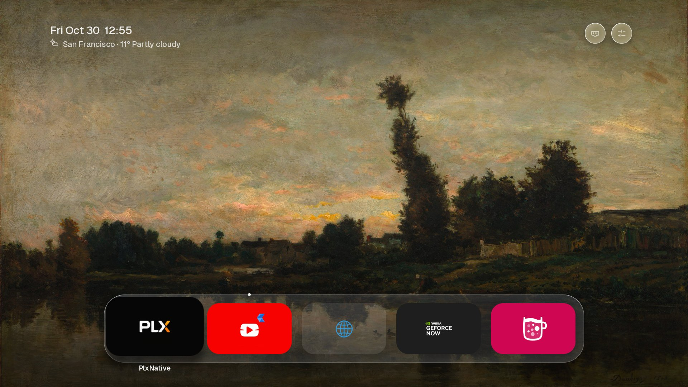
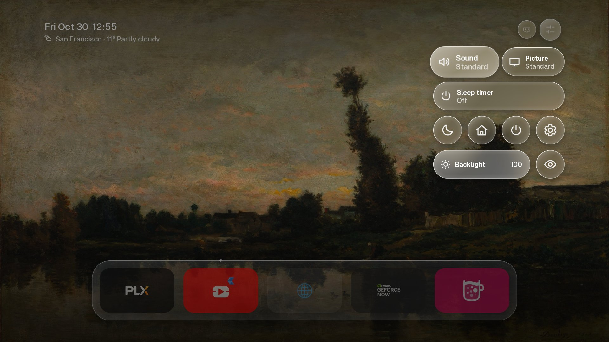
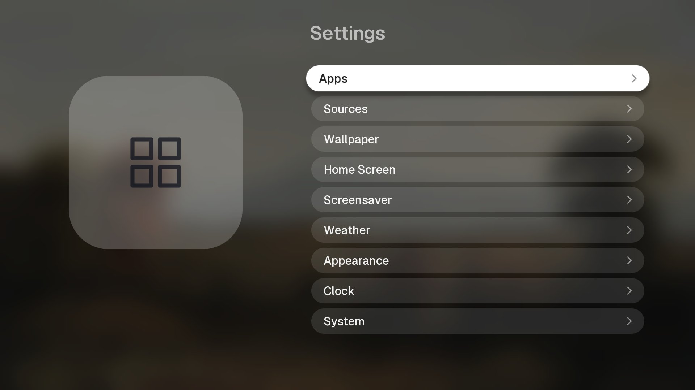
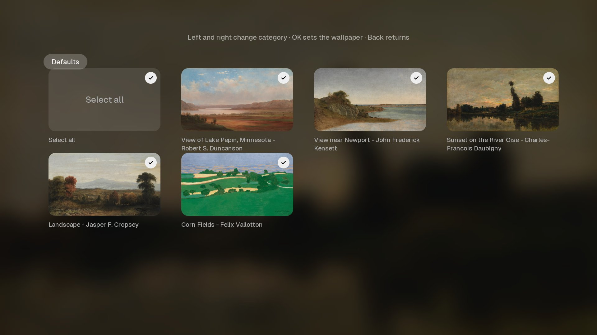
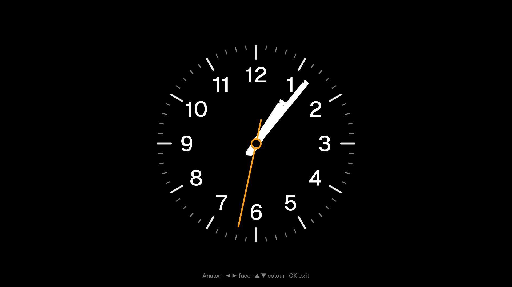

# myTV

**Your TV. Your home screen. No compromises.**

Smart TVs have become slow and cluttered: sluggish menus, web-based interfaces, and sponsored
content nobody asked for.

myTV takes a different approach. It's a fast, native, tvOS-style home screen for LG webOS TVs with
the Homebrew Channel. Written in C and rendered directly on the TV's GPU, it responds instantly and
stays out of your way.



| Control Center | Settings |
|---|---|
|  |  |
| **Wallpapers** | **StandBy** |
|  |  |

## Why myTV?

- **Truly native.** Built with C, SDL2, and LVGL. No browser engine, WebView, or JavaScript.
- **Smooth scrolling.** Frame pacing keeps long lists running steadily at 60 fps.
- **Minimal overhead.** Glass effects are pre-blurred, not recomputed every frame. Near-zero CPU
  usage when idle.
- **No clutter.** No ads, sponsored rows, accounts, or analytics.
- **Everything within reach.** Control Center gives you quick access to sound and picture modes,
  sleep timer, and backlight.
- **Make it yours.** Your apps, five public-domain paintings, clocks, and a screensaver.
- **Open source.** MIT-licensed. Read it, build it, change it.

## Compatibility

Tested on LG OLED C1 (webOS 6.5.3). Other webOS 6+ models are expected to work but haven't been
tested yet.

Root access is not required for basic functionality. On rooted TVs, myTV can replace the default
Home screen. Uninstalling restores the original behaviour, including the Home button.

## Credits

Inspired by [Lumen](https://github.com/ammar027/lumen-webos), a web-based launcher for webOS. myTV
follows its visual design and interaction patterns, rebuilt from scratch in C.

## Features

- **Home screen.** A glass dock of apps over the wallpaper, a second row and recent apps that appear
  as you move down, focus lift and name under the focused tile, running-app dots. Apps per row,
  hidden names, dock dimming and focus strength are settings.
- **App management.** Hold OK for a menu: move, remove from Home, uninstall, recent apps. The pointer (Magic
  Remote) works too: hover to focus, hold and drag to move an app.
- **Control Center.** Sound and picture mode, sleep timer, screen off, backlight, eye comfort, LG
  Home and the TV's Settings.
- **Wallpapers.** Five public-domain paintings bundled, change on startup or on a timer, night
  dimming, or a plain colour background.
- **Screensaver.** By default the TV's own screensaver runs on the TV's own timer, as without myTV.
  Or myTV takes over with a photo slideshow with a clock, or StandBy: eight clock faces with colours
  and a night mode.
- **Top bar.** Date, time and weather for a chosen city (about 180 cities, Open-Meteo), Inputs.
- **Clock styles.** Digital, with date, with seconds, analog or both. Colour, layout, size, weight
  and position are settings.
- **Home button.** With root, the remote's Home button opens myTV instead of LG Home, and the TV
  comes back to myTV after standby (it stays on an HDMI input if that was in front). A setting in
  System turns it on and off. The LG Home tile in Control Center still opens LG Home.

Settings that the TV already has (language, time zone, 12/24 h) are not duplicated: myTV follows
the TV.

## Install

myTV needs a TV with the [Homebrew Channel](https://www.webosbrew.org/). Root is optional: without
it, the Home button keeps opening LG Home, and Screen off and Start screensaver do not work.

The Home button hook loads a small library into the TV's input daemons (`lginput2` and
`micomservice`) with [ezinject](https://github.com/smx-smx/ezinject). If
[LG Input Hook](https://github.com/Simon34545/lginputhook) already binds the Home button, myTV leaves
it alone. After myTV is uninstalled, Home opens LG Home again at once, and the hook is gone after
the next reboot.

Download the `.ipk` from [Releases](https://github.com/ViieeS/mytvlauncher/releases) and install it
with the Homebrew Channel, [webOS Dev Manager](https://github.com/webosbrew/dev-manager-desktop) or
`ares-install`.

## Build

The toolchain is the webOS buildroot SDK from
[openlgtv/buildroot-nc4](https://github.com/openlgtv/buildroot-nc4), and SDL2 comes from
[webosbrew/SDL-webOS](https://github.com/webosbrew/SDL-webOS). On Linux:

```bash
make deps
make ipk
```

`build/` then holds `com.viiees.mytvlauncher_<version>_arm.ipk` and its Homebrew Channel manifest.
`make deps` downloads prebuilt toolchains for Linux x86_64 and aarch64 only. On macOS, build in a
Linux container, or pass a toolchain you built yourself:
`make ipk TOOLCHAIN=/path/to/arm-webos-linux-gnueabi_sdk-buildroot SDL=/path/to/sdl`.

The fonts and icons in `assets/` are generated C sources. To regenerate them, run `make assets`
(needs Python with Pillow and fontTools, and `rsvg-convert`).

## Development on a TV

With telnet root on the TV (Homebrew Channel enables it), `tools/tv/` installs and updates the app
without the webOS CLI:

```bash
sh tools/tv/install.sh <tv-ip>
sh tools/tv/deploy.sh <tv-ip>
```

`install.sh` uploads and installs `build/*.ipk`. `deploy.sh` replaces only the binary and relaunches
the app (by default the debug build from `make DEBUG=1`). The debug build logs to `/tmp/launcher.log`
on the TV.

## Layout

| Path | What |
|---|---|
| `src/main.c` | the UI: home screen, Control Center, Settings, input, Luna calls |
| `src/screensaver.c` | photo screensaver and StandBy |
| `src/glass.c` | pre-blurred glass textures, built on a worker thread |
| `homehook/` | the root-only Home button hook: the injected library, its watcher script, the ezinject build and patch |
| `third_party/lvgl` | LVGL 8.3.11 with local patches to its SDL renderer, see `third_party/lvgl-v8.3.11-sdl.patch` |
| `assets/` | generated fonts, icons and the weather city table |
| `package/` | `appinfo.json`, icons, bundled wallpapers |
| `tools/` | asset generators, `make_ipk.py`, `fetch_deps.sh` |

## Licence

MIT, see [LICENSE](LICENSE). Third-party code, fonts and pictures keep their own licences, see
[THIRD_PARTY_NOTICES.md](THIRD_PARTY_NOTICES.md).

myTV is not affiliated with or endorsed by LG Electronics or Apple. "LG" and "webOS" are trademarks
of LG Electronics.
